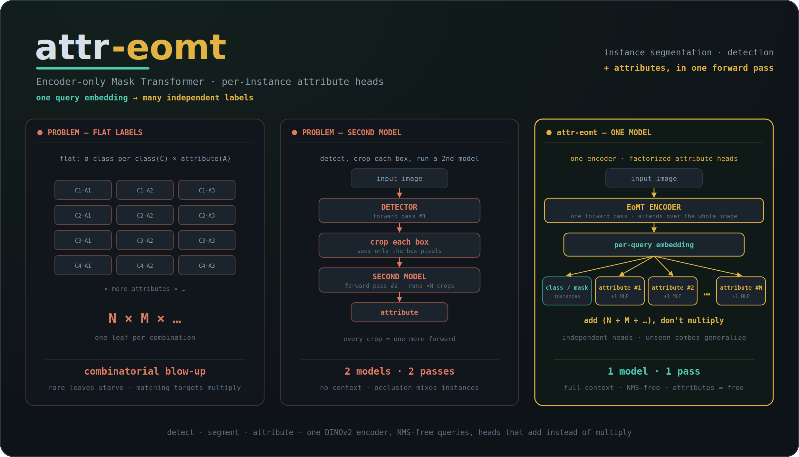
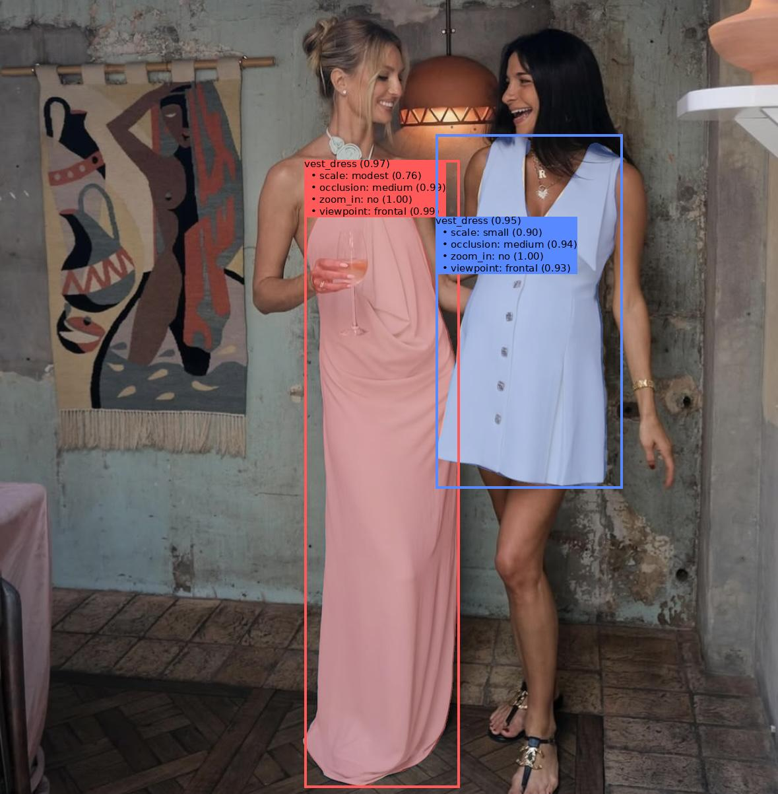

<div align="center">



<p>
  <a href="https://pypi.org/project/attr-eomt/"></a>
  <a href="https://pypi.org/project/attr-eomt/"></a>
  <a href="LICENSE"></a>
  <a href="https://imagra93.github.io/attr-eomt"></a>
</p>

**One query embedding, many independent labels.**

📖 **[Read the annotated explainer →](https://imagra93.github.io/attr-eomt)**

</div>

---

## What it is

**attr-eomt** is a standalone **EoMT** (Encoder-only Mask Transformer, CVPR 2025) for instance segmentation and
object detection on a DINOv2 backbone, built around three things:

1. **Instances with attributes.** Every detected instance gets its class and any number of **independent attributes** —
   categorical (classify) or real-valued (regress) — read off the same per-query embedding the detector computes. No
   second model, no crops, no combinatorial label space.
2. **Several photos of one subject, predicted together** (if you have them labelled): cross-view attention lets each
   photo's queries take what the other photos show, so an instance that is tiny or ambiguous in one photo is found and
   classified with the help of another.
3. **Instance matching across photos** (if you have it labelled): a matching head embeds every instance so that the same
   physical instance in two photos lands close; `match()` turns a folder of photos into one identity per instance.

It is a clean-room, Apache-2.0 reimplementation: the weights you train are yours to release.

```python
from eomt import EoMT

model = EoMT("l")                                  # a new large model (DINOv2 backbone)
model.train(data="run.yaml")                       # the run config: data, attribute heads, settings
model = EoMT("runs/train/my-run")                  # a trained run: everything is read from its checkpoint
model.val()                                        # on its own validation data
results = model.predict("images/", plot=True)      # masks, boxes, classes and attributes per instance
identities = model.match("photos/subject_42/")     # one identity per physical instance across the photos
```

---

## Install

```bash
pip install attr-eomt                  # from PyPI
pip install -e ".[dev]"                # from source (editable; [dev] adds pytest)
```

Python 3.10+, PyTorch 2.4+. Training and inference run in bf16 on GPUs that support it.

---

## Architecture

EoMT is a **DINOv2-with-registers ViT** whose last four transformer blocks also process a fixed set of **learnable
queries** (the Mask2Former idea): each query latches onto one object instance, and after the encoder every query emits
one vector, the **per-query embedding** `[B, Q, hidden]`. A class head and a mask head (or a box head for the
`detect` family) turn it into predictions. It is **NMS-free**, so two overlapping objects stay two queries — which is
what keeps attributes attached to the right instance.

The attribute heads tap the **same embedding**: each is a small MLP, trained on the queries the detector's Hungarian
matcher assigned to an instance. The optional matching head reads it too, and the optional cross-view sublayers let the
queries of several photos of one subject attend to each other's tokens.

| size | backbone        | hidden | layers | queries | params |
|------|-----------------|--------|--------|---------|--------|
| `s`  | DINOv2-small    | 384    | 12     | 100     | 24 M   |
| `b`  | DINOv2-base     | 768    | 12     | 200     | 94 M   |
| `l`  | DINOv2-large    | 1024   | 24     | 200     | 317 M  |

The default input is 644 px (patch-14 aligned, so DINOv2's weights load 1:1). Two families: `instance` (masks, the
default) and `detect` (boxes only, a DETR-style box head).

What differs from the reference EoMT, all on by default and measured on real data:

- **Small objects stay visible.** Masked attention max-pools the mask logits onto the patch grid (a query whose mask
  touches no patch attends to all of them, as in Mask2Former), matching scores every query on every cell of the mask
  grid, and dice is computed on every GT pixel — so instances of a few pixels are matched and supervised.
- **A multi-scale pyramid** (ViTDet-style FPN) that the queries cross-attend to.
- **Scores that rank masks by quality**: IoU-aware class targets and a mask-quality head (Mask Scoring R-CNN).

---
## Factorizing the label space

This is the contribution. Conventional detectors fold every distinction into one flat
label space: an object's `type × viewpoint × occlusion × …` becomes a Cartesian product of
leaf classes that explodes combinatorially, starves each leaf of examples, and multiplies
the Hungarian matcher's targets. **attr-eomt factorizes instead** — a small, general primary
head plus independent attribute heads that **add, not multiply**.

Because the heads are independent, the primary taxonomy stays compact and every class keeps
its full sample count; attributes ride along for near-zero compute; and the model composes
`attribute × class` combinations that **never appear in the training data** — combinations a
flat label space cannot even represent.

### Example: clothing with per-instance attributes

One model segments each garment (primary classes like `vest_dress` / `short_sleeve_top`
/ `long_sleeve_dress` / `skirt` / `trousers` …) and, for **every** detection, reads off
four **independent** attribute heads — `scale` (`small` / `modest` / `large`),
`occlusion` (`no` / `slight` / `medium`), `zoom_in` (`no` / `medium` / `large`) and
`viewpoint` (`frontal` / `side` / `back`). The renderer prints the primary class + score
on the first row and each attribute + its confidence on the rows beneath it.



The four attributes are *orthogonal* to the garment class — they vary independently —
which is exactly the case that's awkward to fold into the primary class space. The same
pattern fits any "class **plus** per-instance sub-labels" task: **retail shelves →
product + facing**, **documents → element + role**, **cells → type + health**.

> Trained on the public **[DeepFashion2](https://github.com/switchablenorms/DeepFashion2)**
> dataset (13 garment classes + 4 attribute heads) and rendered with the package's own
> renderer ([`eomt.visualize.draw_instances`](eomt/visualize.py)).

---

## Data

A COCO instance-segmentation (or detection) JSON. Everything the model needs is read from it: the classes from
`categories`, the attribute heads from two additions.

**1. A top-level `attributes` list**, one entry per attribute, with its categories, or `"type": "regression"`:

```jsonc
"attributes": [
  {"name": "scale", "categories": [{"id": 1, "name": "small"}, {"id": 2, "name": "modest"}, {"id": 3, "name": "large"}]},
  {"name": "price", "type": "regression", "unit": "EUR"}
]
```

**2. A per-annotation `attributes` map**, `{attribute: value}`:

```jsonc
{"id": 1, "image_id": 42, "category_id": 1, "segmentation": [...], "bbox": [...], "attributes": {"scale": 3, "price": 812.5}}
```

Raw ids are remapped to `0..n-1` per attribute. A **missing or unknown value is ignored** by that attribute's loss, never
trained as class 0, so a partly tagged dataset is fine; a JSON without `attributes` is plain instance segmentation.
The attributes can also live beside a plain COCO file: an `attributes.yaml` schema in the dataset root plus
`attributes/<split>.json` values keyed by annotation id. [`sample_data/`](sample_data/) holds a tiny example.

**Photos of one subject** (for `multiview`) add to the same file:

| key | meaning |
|-----|---------|
| image `subject_id` | photos with the same id show the same subject; photos without one take no part in the sets |
| annotation `instance_id` | the same physical instance in every photo of the subject that shows it (a number or a string); the matching head learns these links |
| image `supervision` | `full` (default): every instance is annotated. `positives`: only some are, so nothing unannotated is taught as background. `none`: the photo is only input for the others |
| annotation `iscrowd: 1` | a region left out of the loss: detections there are neither right nor wrong |

`eomt.data.subjects_from_file_names` sets `subject_id` from file names that start with the subject (`<subject>_...`).

---

## The run config

**The dataset holds the data; one YAML holds the run.** Its sections are the settings of `train()`, each with the
reference recipe as its default, so a run config only says what differs. Start from the commented template
[`sample_data/run.yaml`](sample_data/run.yaml):

```yaml
path: datasets/garments                  # data: paths relative to this file
train_images: images/train
train_json: annotations/train.json
val_images: images/val
val_json: annotations/val.json

attributes:                              # which attributes get a head, and how each learns
  scale:
  side: {flip_aware: {left: right}}      # swapped when the augmentation mirrors the photo
  price: {log: true, range: [0, 20000], applies_to: [sofa]}

train: {epochs: 12, batch: 4, imgsz: 644}
aug: {min_scale: 0.4, max_scale: 1.6}
inference: {conf_thres: 0.3}             # saved with the model: the defaults of predict() / match()
```

| section | what it holds (`eomt.engine.train`) |
|---------|--------------------------------------|
| `train` | the keywords of `train()`: `epochs`, `batch` (per GPU), `nominal_batch` (16: the rest is accumulated), `imgsz`, `workers`, `seed`, `init_weights`, `project` / `name`, `stop_after_epochs` |
| `model` | the architecture and loss weights of a new model (`ModelConfig`): `fpn_scales`, `num_upscale_blocks`, `iou_aware_cls`, `quality_weight`, the attribute heads' shape |
| `optim` | `OptimConfig`: `lr0`, `llrd`, `warmup_steps`, `poly_power`, `clip_norm`, `ema_decay`, `mask_anneal` |
| `aux` | how the attribute heads train (`AuxConfig`): `w`, `per_head`, `class_weights`, `iou_gate`, `class_gate` |
| `aug` | the augmentation (`AugConfig`) |
| `val` | `ValConfig`: `interval`, `imgsz`, `group_by` (metrics per value of an image field), `best_key` |
| `multiview` | a post-training on photos of one subject (`MultiviewConfig`, below) |
| `attributes`, `inference` | the heads and how each learns; the predict defaults saved in the checkpoint |

Arguments beat the file: a keyword of `EoMT.train()` replaces a `train` value, and a section given as a mapping is merged
over the YAML's key by key (`model.train(data="run.yaml", optim={"lr0": 5e-5})`). An unknown key stops the run before it
starts. The resolved run is written to `args.yaml` in the run folder and into every checkpoint.

```bash
python scripts/train.py --data run.yaml --size l --device 0,1                    # the run as its YAML says, two GPUs
python scripts/train.py --data run.yaml --epochs 1 --set optim.lr0=5e-5          # any setting: --set SECTION.KEY=VALUE
python scripts/train.py --data run.yaml --weights best.pt --set optim.mask_anneal=false   # warm start
python scripts/train.py --data run.yaml --resume runs/train/my-run                # continue a run exactly
```

---

## Attributes

- **Categorical** heads train with cross-entropy, **regression** heads with a Huber loss on the standardized value
  (`log1p` first with `log: true`, for heavy-tailed positives); predictions come back in real units (`aux_values`),
  clipped to `range`.
- **`applies_to`** (class names) scopes a head to some classes: it trains only on them and reports `ids = -1` ("not
  applicable") for the others. Different attributes can attach to different classes in one model.
- **`flip_aware`** (`{left: right}`) swaps an attribute that encodes a side when the augmentation mirrors the photo,
  and test-time augmentation swaps it back. Keep `vflip_prob` / `rot90_prob` off for such an attribute.
- **`crop`** (regression): `scale` makes the value follow the share of the instance the augmentation keeps in view (an
  extensive quantity such as a surface), `ignore` drops it below `min_visible` (a property of the whole instance).
- **`bins`** (regression) reports the errors per GT-value bucket too.

Validation reports `aux_acc/<head>` (accuracy) and `aux_mae/<head>` (mean absolute error in real units; a `log` head
also `aux_logmae` and `aux_ratio`, the median of prediction / GT).

---

## Several photos of one subject

A **multi-view post-training** adds to a trained single-photo model what you have labelled:

- **`xview`** — cross-view attention after each query block: the queries of each photo of a set attend to the tokens of
  the other photos (plus a null token, to abstain). Each photo's masks still cover only what it shows. It starts as the
  identity, and a photo alone is predicted exactly as before.
- **`matching`** — a head that embeds every instance (the per-query embedding plus a learned residual, so it starts as
  re-identification), trained with a sigmoid loss on the `instance_id` links so that one global threshold separates
  "same instance" from "another one". It trains with or without `xview`.

```yaml
train: {init_weights: runs/train/my-run/weights/best.pt, epochs: 4, batch: 1}   # batch counts sets of photos
val: {interval: 1}
multiview:
  xview: true
  matching: true
  gate: [class]                       # links only between instances of the same class (and listed attributes)
  trainable: new                      # only the added modules; "query_blocks" also trains the query blocks, slower
  sets: {max_views: 4, sizes: {2: 0.2, 3: 0.2, 4: 0.6}, p_single: 0.3, p_shared: 0.5, p_hard: 0.25}
```

Every photo of a subject is the anchor of one set per epoch, with companions from the same subject (`p_shared` of the
sets first take those that show one of its linked instances). The horizontal flip is drawn once per set, so left and
right never mix within a subject. `p_hard` makes the anchor hard to read alone (shrunk, degraded, a close-up or
occluded) while its companions stay as they are, so the evidence has to come from them. `trainable` also takes
`{group or parameter-name prefix: LR multiplier}` (groups `xview`, `match_head`, `query_blocks`, `heads`; e.g.
`{xview: 1.0, aux_heads.price: 0.0}`).

**Validation** scores fixed sets of the validation photos of each subject, unaugmented and placed exactly as inference
places them: `sets/segm/mAP_{alone,set}` (each photo predicted alone and with its set; `_linked_` restricted to the
instances another photo shows, where the others can help), the attributes alone and with the set, and the links:
`sets/match/{f1,precision,recall,thres}` (the embedding inference links with), `sets/reid/*` (the baseline:
re-identification of the photos predicted alone), `_gated` within the gate, `match/f1_stored` at the threshold stored
before the validation, and `*/cluster_f1` (B-cubed F1 of the identities over each whole subject). The best threshold is
stored in the checkpoint: inference links with it.

```python
EoMT("runs/train/mv").val(multiview=True)                                  # the run's own validation, standalone
EoMT("other.pt").val(multiview=True, run="runs/train/mv",                  # another model, scored as that run did,
                     sets_file="runs/train/mv/val_sets.json")              # on the same fixed sets
```

**Inference.** `predict(source, subject=True)` predicts the photos of each subject together (`source` holds one
subject's photos, or a subfolder per subject), `max_views` at a time. `match(folder)` links the detections of every
photo of a subject — any number of photos — into identities, with the stored threshold and gate:

```python
out = EoMT("runs/train/mv").match("photos/subject_42/", groups=[[0, 3, 4], [1, 2]])   # groups: optional
out["images"][0]["identity_ids"]         # an identity per detection of photo 0
out["identities"][0]["attributes"]       # the identity's attributes, voted over its photos (regression: fused)
```

A model without a matching head links by the per-query embedding (re-identification, nothing trained for it), at 0.7
within the same class unless it was calibrated.

---

## Training recipe

`train()` follows the reference EoMT recipe, checked numerically against the official code: AdamW at `lr0=1e-4` with
layer-wise LR decay `0.8` (the top ViT block at the full LR: the last blocks process the queries), a two-stage warmup
(the head first, the ViT held at 0) and polynomial decay to 0, masked attention annealed block by block so the last
sixth of training is mask-free, and an EMA of the weights. `epochs=12` is the official COCO instance recipe.

Validation runs in the regime the model is trained in (masked attention at the epoch's annealing), so `best.pt` — the
EMA weights, mask-free — is only chosen once the annealing is over. `last.pt` (the trainer state) is written before
each validation, so a crash there costs only the validation. Every checkpoint records its epoch, metrics row and the
resolved run, with the warm-start weights and the data files and their SHA-256.

A **short fine-tune** wants its own recipe: a lower `optim.lr0`, a shorter `optim.warmup_steps`, a lower
`optim.ema_decay`, and `optim.mask_anneal: false` for a model deployed mask-free.

**Several GPUs**: `device="0,1"` trains with one process per GPU; `batch` is per GPU and `nominal_batch` stays the global
batch, so the optimizer steps are those of one GPU. Write the training call under `if __name__ == "__main__":` (the
processes are spawned).

---

## Inference

```python
m = EoMT("runs/train/my-run")
for r in m.predict("folder/", batch=16, stream=True):     # a generator: a large folder is never held in memory
    r["boxes"], r["scores"], r["classes"], r["masks"], r.get("aux"), r.get("aux_values")
m.predict("big_photo.jpg", tiles=True)                     # native-resolution tiles + the whole image, merged
m.predict("photo.jpg", augment={"flip": True})             # test-time augmentation (flip-aware heads swapped back)
m.save("best_bf16.pt", dtype="bf16")                       # half the file, the same scores
```

`conf_thres`, `max_det` and `mask_thresh` default to the checkpoint's `inference` settings. Masks come back at the
photo's resolution; the network runs in bf16 on a GPU (`amp=False`: fp32).

## Checkpoints

A checkpoint is a self-describing `torch.save` dict: the weights plus everything needed to rebuild and run the model
(size, classes, attribute heads, input size and preprocessing, link calibration, inference settings, the run). It loads
with `weights_only=True`, so loading one never runs code. Checkpoints of earlier versions are upgraded on load
(`eomt.migrate_checkpoint`). `scripts/info.py <ckpt>` prints one.

---

## Command line

| script | does |
|--------|------|
| `scripts/train.py` | train from a run config (`--set SECTION.KEY=VALUE` for any setting) |
| `scripts/val.py` | validate (`--augment`, `--tiles`, `--flip`, `--multiview`, `--run`, `--sets-file`) |
| `scripts/predict.py` | predict and render images (`--subject`, `--tiles`, `--batch`) |
| `scripts/match.py` | link the instances of a subject's photos (`--each-subdir`) |
| `scripts/export.py` | a bf16 copy of a checkpoint |
| `scripts/info.py` | a checkpoint's metadata |

---

## Roadmap

- Pretrained COCO weights on the Hugging Face Hub (`EoMT.from_pretrained` is in place), a runnable sample dataset, and a
  public multi-photo dataset for `multiview` and matching.
- ONNX / TensorRT export.

## License

Apache-2.0. EoMT and DINOv2-with-registers are Apache-2.0 too.
